<div align="center">

# Moon Factory

### Your codebase, a living world.

Turn an open-source GitHub repository into a world you can explore.<br />
See the architecture. Follow the work. Find your next move.

**[Explore the live site ↗](https://chaorders.com/github-factory/)** · **[简体中文](README.zh-CN.md)** · [Quick start](#run-it-locally) · [How it works](#from-repository-to-world)

[](LICENSE)
[](https://bun.sh)
[](README.zh-CN.md)
[](https://github.com/luworks/github-factory/actions/workflows/ci.yml)

[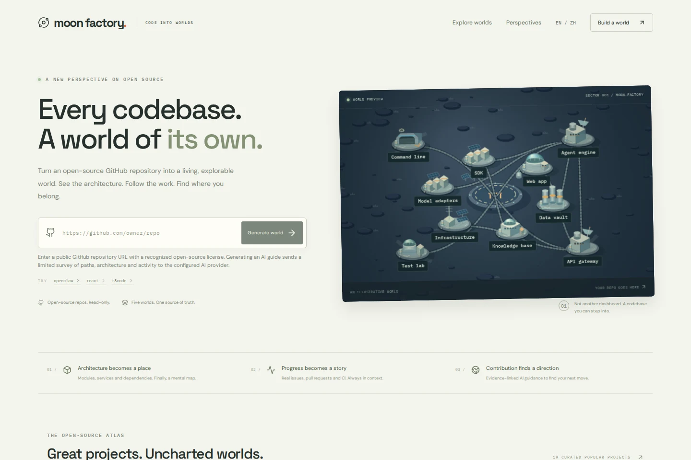](https://chaorders.com/github-factory/)

*Code into worlds. Five perspectives. One source of truth.*

</div>

## See it in motion

A moon base, an industrial network, a command center, a fortified city, a hexagonal civilization. Switch the visual language while keeping the same repository, district identities and source evidence.

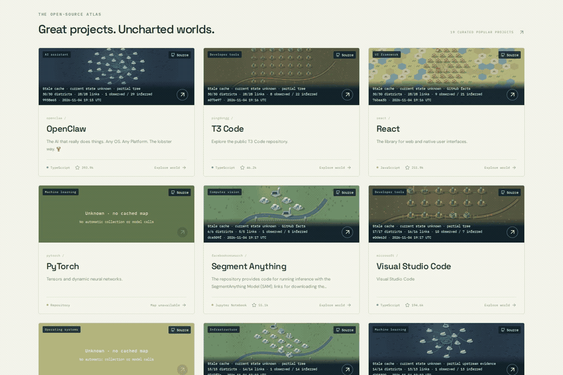

<table>
<tr>
<td width="50%" align="center">
<a href="https://raw.githubusercontent.com/luworks/github-factory/main/docs/assets/readme/world-tour.mp4">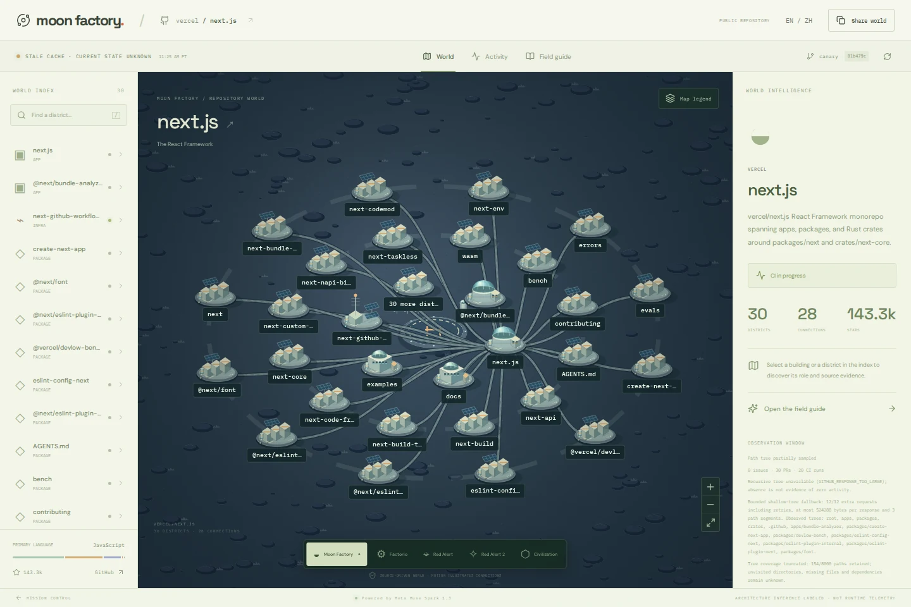</a>
<br /><strong>▶ World tour</strong><br />
<a href="https://raw.githubusercontent.com/luworks/github-factory/main/docs/assets/readme/world-tour.mp4">Watch / download MP4 · 14 seconds</a>
</td>
<td width="50%" align="center">
<a href="https://raw.githubusercontent.com/luworks/github-factory/main/docs/assets/readme/evidence-tour.mp4">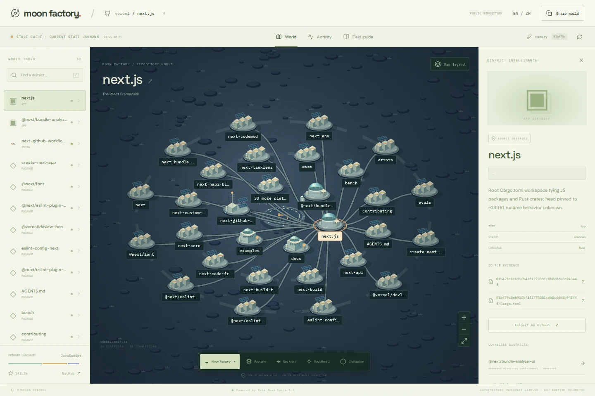</a>
<br /><strong>▶ From source to next steps</strong><br />
<a href="https://raw.githubusercontent.com/luworks/github-factory/main/docs/assets/readme/evidence-tour.mp4">Watch / download MP4 · 8 seconds</a>
</td>
</tr>
</table>

*Silent product recordings; click either poster for the MP4. GitHub README playback depends on your browser, so the GIFs provide inline previews. [Media provenance and limits](docs/assets/readme/README.md).*

## From repository to world

1. **Choose a public, open-source repository.** Paste its GitHub root URL, or explore an available cached world in the atlas.
2. **Read the landscape.** Paths and manifests become districts; source evidence and structural inference explain the connections.
3. **Inspect a place.** Select a district to see its role, evidence state and links pinned to the captured source head.
4. **Follow the work.** Read issues, pull requests, commits and workflow results in context. Success, failure, skipped and missing evidence stay distinct.
5. **Find a next step.** Read the deterministic architecture guide, or explicitly request an optional AI guide when the configured provider and budget allow it.

| Explore | Understand | Stay grounded |
| --- | --- | --- |
| Pan, zoom, search and select districts | Source-linked architecture and suggested next steps | Observed / inferred / unknown states |
| Five original procedural styles | Issues, pull requests, commits and CI activity | Captured head, timestamp and coverage |
| English and Chinese interface | Shareable world URLs | Explicit stale, partial and unavailable states |

## One repository. Five worlds.

These are five views of the **same cached Next.js repository**, rendered by the actual application. All artwork is procedural; no game assets are included.

<table>
<tr>
<td align="center" colspan="2"><strong>01 · Moon Factory</strong><br />A quiet lunar outpost, connected by orbital infrastructure.<br /></td>
</tr>
<tr>
<td width="50%" align="center"><strong>02 · Factorio inspired</strong><br />Production lines and industrial districts.<br />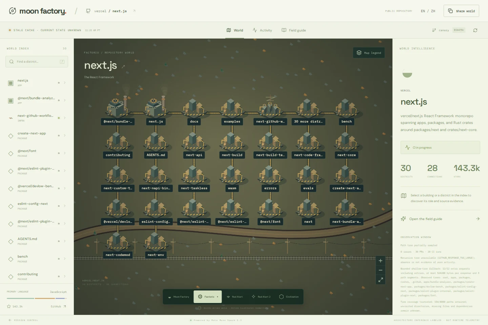</td>
<td width="50%" align="center"><strong>03 · Red Alert inspired</strong><br />A tactical view of the codebase.<br />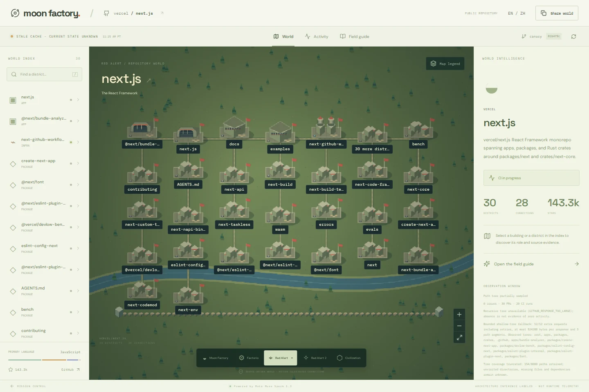</td>
</tr>
<tr>
<td align="center"><strong>04 · Red Alert 2 inspired</strong><br />An isometric command-center skyline.<br />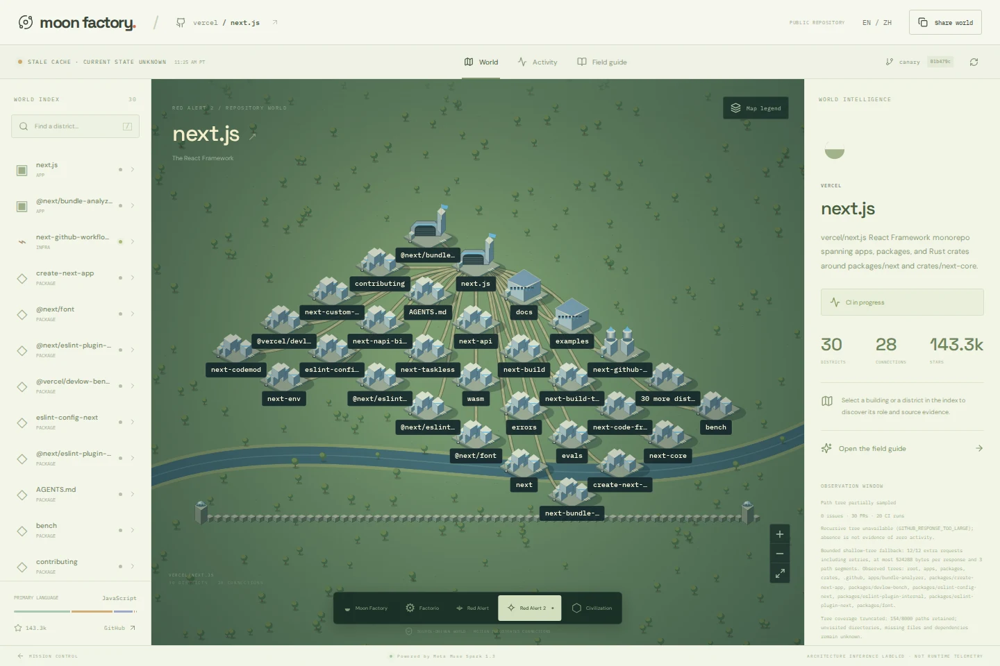</td>
<td align="center"><strong>05 · Civilization inspired</strong><br />A hex-grid landscape of settlements.<br />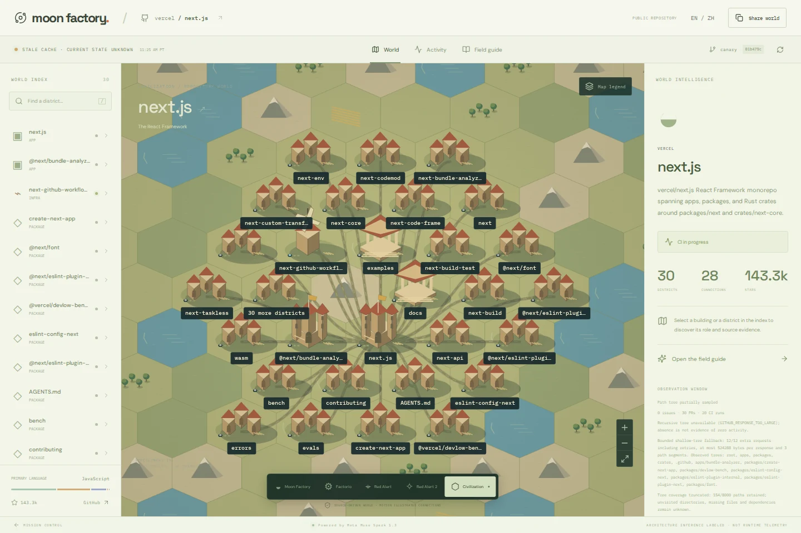</td>
</tr>
</table>

## Every district has a source

The map is a way into the evidence. Open a district, inspect its source, then move between activity and the field guide without losing the repository context.

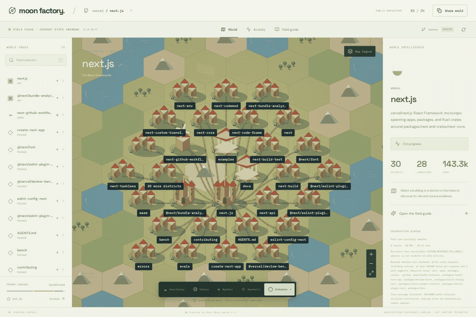

<table>
<tr>
<td width="50%">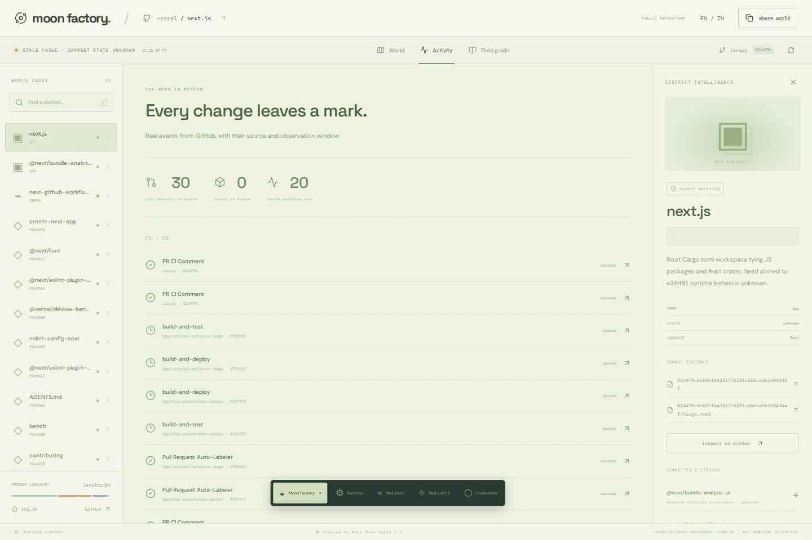<br /><strong>Follow actual work</strong> — workflow results retain their original links and conclusions.</td>
<td width="50%">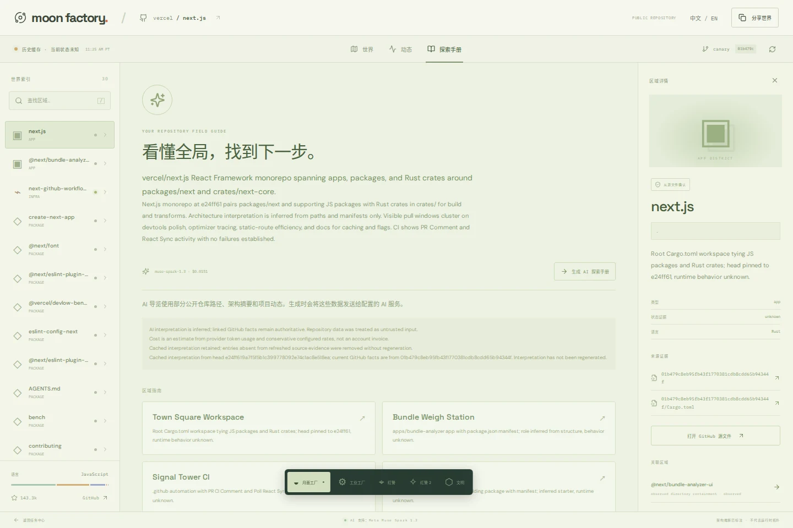<br /><strong>Read in your language</strong> — switch between English and Chinese throughout the experience.</td>
</tr>
</table>

**Observed** means supported by captured source evidence. **Inferred** means a structural interpretation. **Unknown** means the evidence does not establish the fact. Moving particles illustrate connections; they do not measure runtime traffic. A historical green workflow is not proof of current deployment health.

## An atlas of open source

Browse nineteen editorial entries across developer tools, frameworks, languages and infrastructure. Available previews use real cached maps; missing maps remain explicitly unavailable. The catalog is not a claim that every project has a fresh, complete collection.

[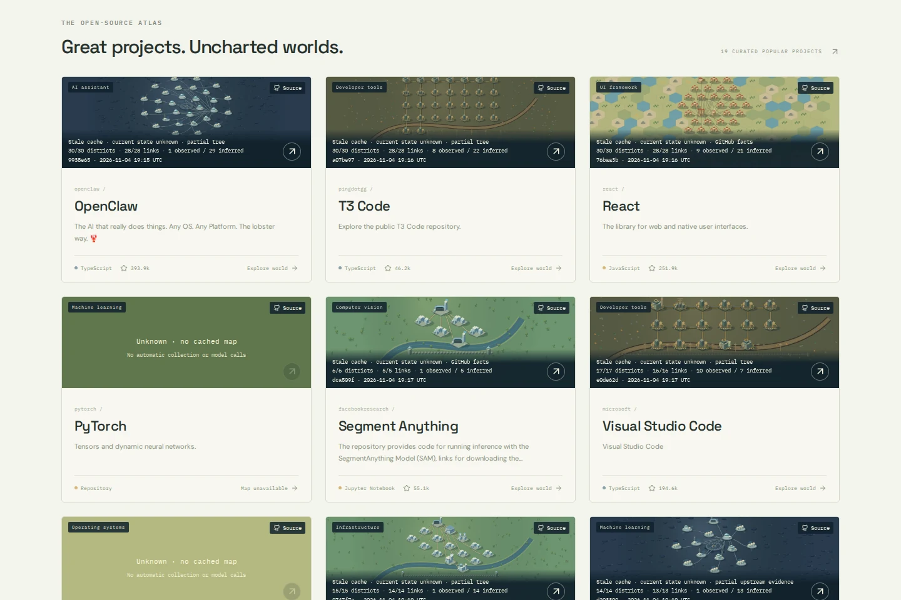](https://chaorders.com/github-factory/#worlds)

<div align="center">

**[Find a world to explore →](https://chaorders.com/github-factory/#worlds)**

</div>

## Run it locally

Built with **TanStack Start · React · TypeScript · Bun · Canvas 2D**. Requires **Bun 1.4.4** and the committed lockfile.

```sh
bun --no-env-file install --frozen-lockfile --ignore-scripts
cp .env.example .env
bun run dev
# http://127.0.0.1:4178/github-factory/
```

A new checkout starts without model credentials and with a **zero model budget**. Deterministic architecture analysis needs no paid API. Authenticated GitHub collection and optional AI use server-only settings in `.env`; never expose credentials through `VITE_` variables. Paid generation requires an explicit action, bounded requests and the persisted concurrency-safe ledger. Preserve the original ledger across provider or release changes.

<details>
<summary><strong>Checks and production build</strong></summary>

```sh
bun run check
bun run test
bun run build
HOST=127.0.0.1 PORT=4177 bun run start
# In another terminal, against the running local app:
bunx --no-install playwright install chromium
bun run test:browser
```

Browser journeys intercept APIs with clearly labeled synthetic fixtures; they do not spend paid model quota. Local checks, CI, public runtime adoption and real provider acceptance are separate evidence.

</details>

<details>
<summary><strong>Hosting and base path</strong></summary>

`MOONSHOT_BASE_PATH` is a build-time public path, defaulting to `/github-factory/`. To serve the root, build with `MOONSHOT_BASE_PATH=/ bun run build`. Keep the same artifact and path through verification and deployment.

The server needs a persistent Bun host. Local development uses SQLite; production can use Cloudflare D1 for public world snapshots through a private fixed-operation bridge. Model spending, cached guides and admission authorities remain on the persistent host. A Cloudflare Workers site alone cannot run `bun:sqlite`.

See [deployment](docs/DEPLOYMENT.md) and the dated [production acceptance record](docs/PRODUCTION.md).

</details>

## Built to keep evidence visible

The app reads bounded public GitHub metadata, paths and manifests. **It never clones or executes an input repository.** Repository text is untrusted data, never instructions. Refreshing facts or changing styles does not regenerate a paid guide. Secrets, caches, ledgers and private runtime records stay outside Git.

This independent MIT repository is the sole source for future GitHub Factory / Moonshot development. Legacy `MOONSHOT_` setting names and the `/github-factory/` public path remain stable.

| Learn more | |
| --- | --- |
| Product and architecture | [Product design](docs/PRODUCT.md) · [AI and budgets](docs/AI.md) |
| Set up and ship | [Setup](docs/SETUP.md) · [Deployment](docs/DEPLOYMENT.md) · [Production evidence](docs/PRODUCTION.md) |
| Contribute | [Contributing](CONTRIBUTING.md) · [Migration](docs/MIGRATION.md) |
| Media and licensing | [README media](docs/assets/readme/README.md) · [Third-party notices](THIRD_PARTY_NOTICES.md) |

Dated reports in `docs/` retain historical scope and limits; they are not current production guarantees. Film tooling lives in `media/film`; generated speech and the uncleared narrated film remain private and are excluded from this release.

---

<div align="center">

**Every codebase. A world of its own.**

[Open Moon Factory ↗](https://chaorders.com/github-factory/) · [简体中文](README.zh-CN.md) · [MIT License](LICENSE)

Copyright 2026 CHAORDERS LLC. Game names describe visual inspiration; no game assets or endorsement are included.

</div>
