> 当前产品界面仅英文；任何可公开访问的 GitHub 仓库都可分析，许可证只按来源展示。本文与旧截图保留为中文说明及历史记录，不代表当前仍有中文切换入口。

<div align="center">

# Moon Factory · 代码里的世界

### 每一份代码，都有自己的世界。

把开源 GitHub 仓库变成可以探索的地图。<br />
看清架构，追踪进展，找到下一步。

**[进入官网 ↗](https://chaorders.com/github-factory/)** · **[English](README.md)** · [本地运行](#本地运行)

[](LICENSE)
[](https://bun.sh)
[](docs/PRODUCT.md)

[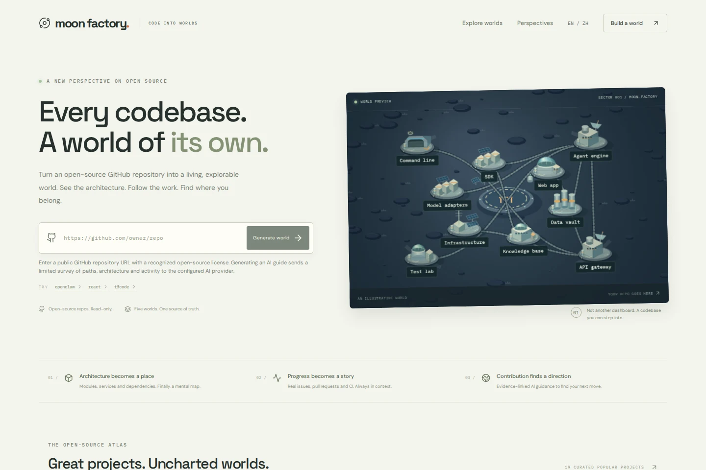](https://chaorders.com/github-factory/)

</div>

## 先看看它如何运转

同一个仓库，可以是月球基地、工业网络、战术指挥部、等距城市，也可以是六边形文明。切换视角时，区域身份、选中状态和源码证据保持一致。

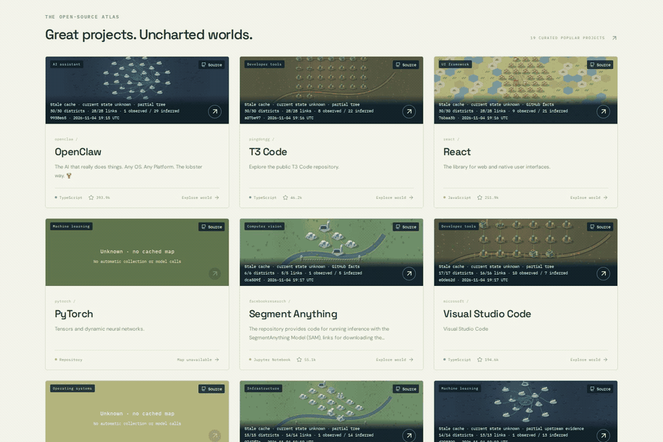

| ▶ 世界漫游 · 14 秒 | ▶ 从源码到行动 · 8 秒 |
| --- | --- |
| [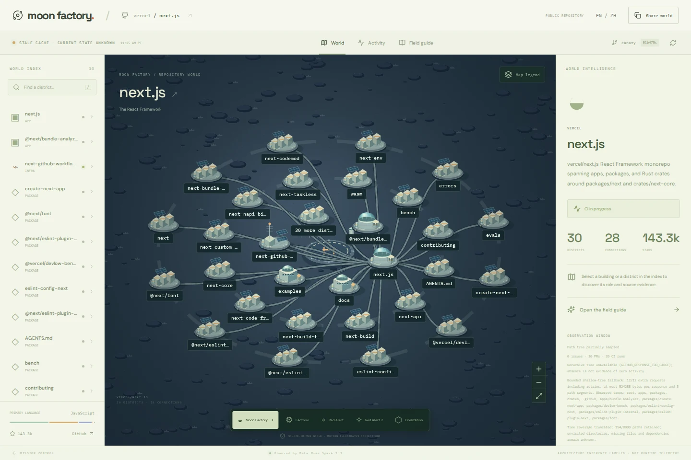](https://raw.githubusercontent.com/luworks/github-factory/main/docs/assets/readme/world-tour.mp4) | [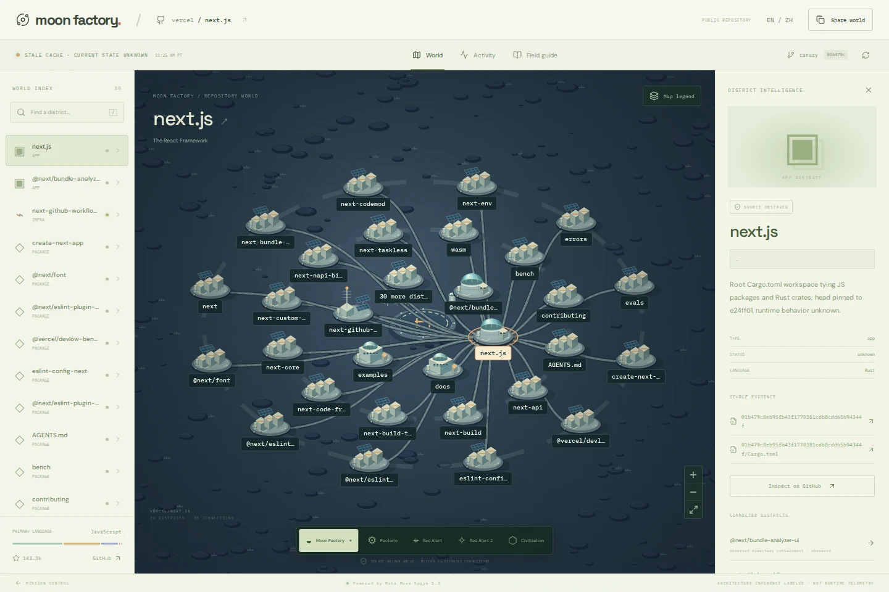](https://raw.githubusercontent.com/luworks/github-factory/main/docs/assets/readme/evidence-tour.mp4) |

点击封面观看或下载 MP4。两段视频均为无声产品录屏；GitHub 内的播放行为取决于浏览器，GIF 可直接在 README 中预览。[素材来源与边界](docs/assets/readme/README.md)。

## 从仓库到世界

1. **选择仓库**：粘贴公开、使用受支持开源许可证的 GitHub 仓库根地址，或从图鉴打开已有缓存地图。
2. **读懂地图**：目录和清单成为区域；连线区分有源码支持的关系与结构推断。
3. **查看证据**：选中区域，查看职责、证据状态与指向采集版本的源码链接。
4. **追踪工作**：在同一个上下文里阅读 Issue、PR、提交和工作流结果；成功、失败、跳过和缺失证据分别展示。
5. **找到下一步**：使用确定性架构指南；服务已配置且预算允许时，可以通过明确操作请求可选 AI 指南。

## 五种原创程序化视角

以下均为实际应用中的同一份 Next.js 历史缓存地图。画面由程序绘制，不包含游戏素材。

| Moon Factory · 月球基地 | Factorio 灵感 · 工业网络 |
| --- | --- |
|  | 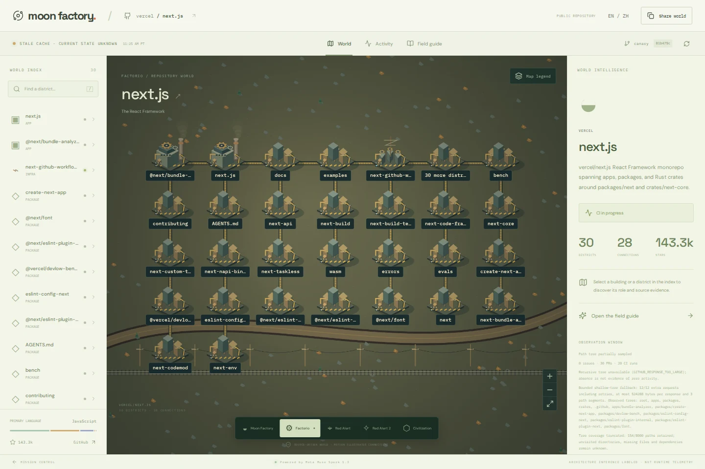 |

| Red Alert 灵感 · 战术地图 | Red Alert 2 灵感 · 等距城市 |
| --- | --- |
| 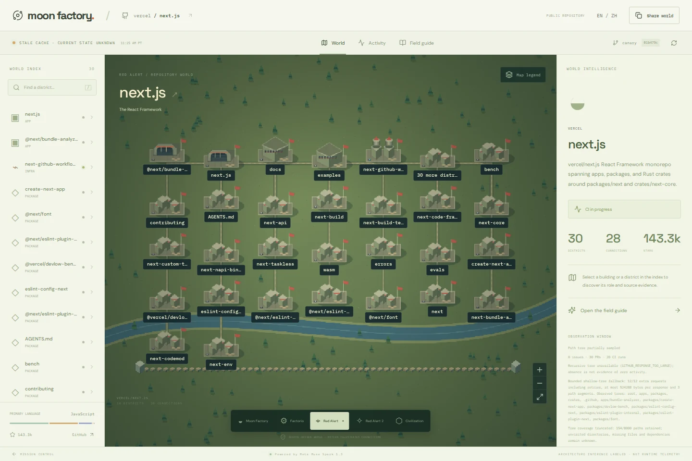 | 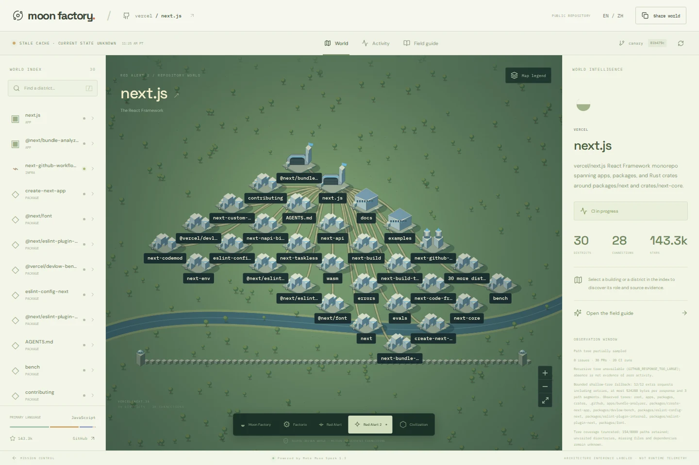 |

**Civilization 灵感 · 六边形文明**

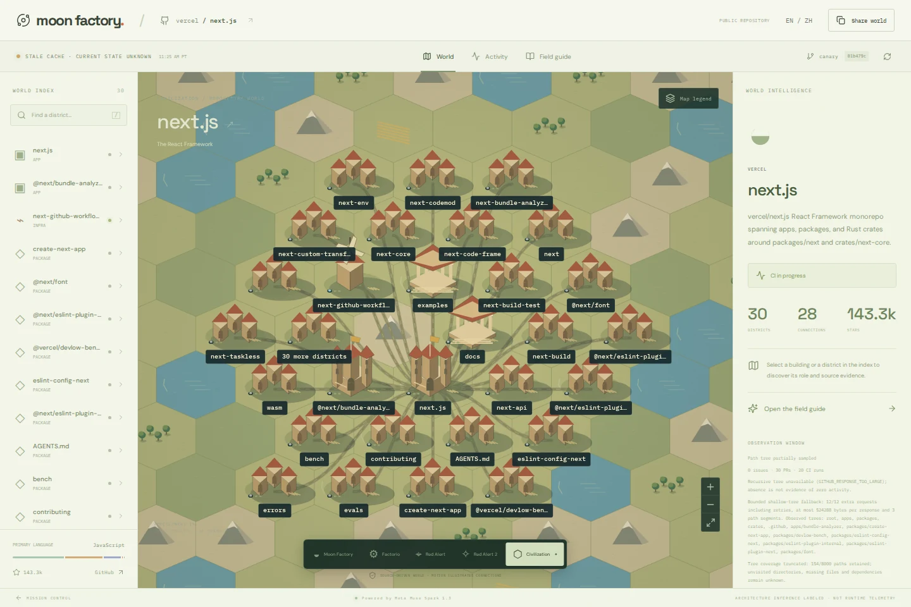

## 每个区域都有出处

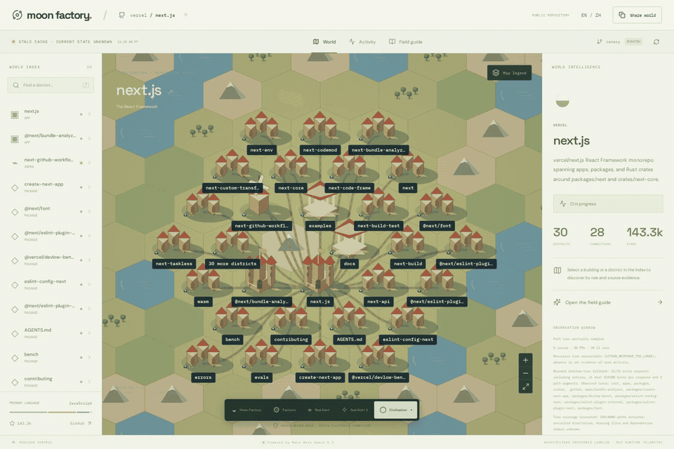

**已观察（observed）**：有采集到的源码证据支持。**推断（inferred）**：根据结构作出的解释。**未知（unknown）**：现有证据无法确定。地图保留版本、采集时间和覆盖范围；历史缓存、部分采集和不可用状态不会被隐藏。移动粒子表示关系，不表示实测流量；旧版本的绿色工作流也不代表当前部署健康。

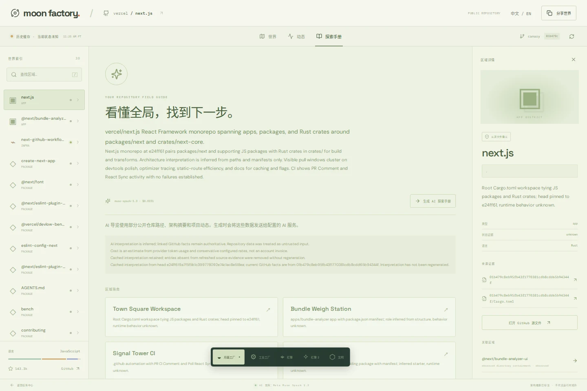

## 探索开源图鉴

十九个编辑精选条目，覆盖开发工具、框架、语言和基础设施。可用预览读取真实缓存；尚无地图的条目会明确显示不可用。图鉴数量不代表已完成同等数量的新鲜、完整采集。

[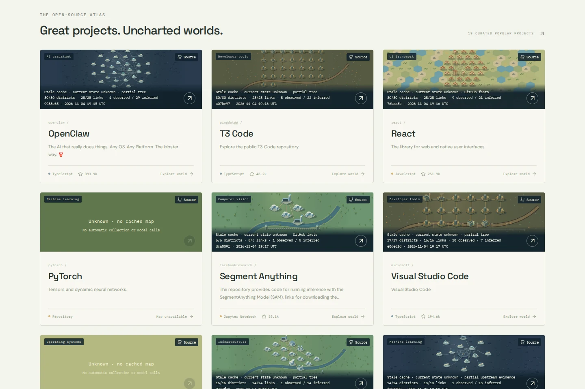](https://chaorders.com/github-factory/#worlds)

**[去官网探索 →](https://chaorders.com/github-factory/)**

## 本地运行

技术栈：**TanStack Start · React · TypeScript · Bun · Canvas 2D**。使用 **Bun 1.4.4** 和仓库内提交的 `bun.lock`。

```sh
bun --no-env-file install --frozen-lockfile --ignore-scripts
cp .env.example .env
bun run dev
# http://127.0.0.1:4178/github-factory/
```

新 checkout 默认没有模型凭据，模型预算为零。确定性架构分析无需付费 API。可选 AI 和 GitHub 认证配置只放在服务端 `.env`，不要使用 `VITE_` 变量存放凭据。模型调用需要明确分析操作、有界请求和持久化、并发安全的预算账本；更换提供方或版本时不得复制、重置或分叉正在使用的付费账本。

```sh
bun run check
bun run test
bun run build
HOST=127.0.0.1 PORT=4177 bun run start
# 另开终端，连接上面的本地应用：
bunx --no-install playwright install chromium
bun run test:browser
```

浏览器测试通过明确标记的合成 API 数据验证界面，不消耗付费模型额度。本地检查、CI、生产版本采用和真实模型验收分别记录。

`MOONSHOT_BASE_PATH` 是构建时公共路径，默认 `/github-factory/`；验证和部署使用同一构建产物及路径。服务端需要持久化 Bun 主机，现有 Cloudflare Workers 网站无法单独运行 `bun:sqlite`。本地世界缓存使用 SQLite；生产可通过私有固定操作桥接使用 D1 存储公开世界快照，付费账本及准入数据仍留在持久化主机。

## 可信边界与文档

只读取有界的公开 GitHub 元数据、路径和清单，**不克隆、不执行输入仓库**。仓库内容是不可信数据，不会成为指令。刷新事实与切换风格不会重新生成付费指南。凭据、原始运行数据、缓存、账本及私有交接记录不进入 Git。

这是后续 GitHub Factory / Moonshot 开发的独立 MIT 源码仓库。历史 `MOONSHOT_` 配置名和 `/github-factory/` 地址保持稳定。

[产品设计](docs/PRODUCT.md) · [AI 与预算](docs/AI.md) · [设置](docs/SETUP.md) · [部署](docs/DEPLOYMENT.md) · [生产验收记录](docs/PRODUCTION.md) · [贡献指南](CONTRIBUTING.md) · [第三方说明](THIRD_PARTY_NOTICES.md)

`docs/` 中带日期的报告保留历史范围与限制，不等于当前生产保证。`media/film` 保留影片工具源码，未获公开授权的合成配音与完整影片仍为私有素材，不在此发布。

---

<div align="center">

**每一份代码，都有自己的世界。**

[进入 Moon Factory ↗](https://chaorders.com/github-factory/) · [English](README.md) · [MIT License](LICENSE)

Copyright 2026 CHAORDERS LLC。游戏名称仅描述视觉灵感，不包含游戏素材或官方背书。

</div>
